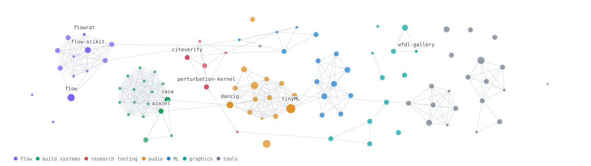

  <picture>
    <source media="(prefers-color-scheme: dark)" srcset="assets/graph-dark.svg">
    
  </picture>

# Abhishek Shivakumar

Compilers, build systems, real-time audio and computational neuroscience.
Cambridge, UK. Founder of [Quilio](https://www.quilio.dev).
Neuroscience at the University of Cambridge, music technology at Birmingham Conservatoire.

    

## Flow

[**Flow**](https://github.com/flooooooooooow/flow) is a statically typed, compiled systems language for programs that evolve through time. It has a self-hosting compiler, a portable C backend and an evolving MLIR backend. Install with `brew tap flooooooooooow/flow && brew install flow`. Flow 1.0.2 and earlier are MIT-licensed; 2.0 and later use a proprietary license.

**[Full Flow source inventory →](FLOW_SOURCES.md)** **5,554 actual `.flow` files, individually linked, across 18 public repositories.** This includes libraries, applications, demos, test programs, compiler fixtures and benchmarks, not just standalone projects. The inventory reflects current default branches; private code and historical/deleted files are excluded.

### Language, compiler and developer tooling

- **[flow](https://github.com/flooooooooooow/flow)** The language, standard library, backends, example galleries and test suites. **3,782 Flow source files.** [(docs, playground and demos)](https://flooooooooooow.github.io/flow/)
- **[flow-compiler](https://github.com/flooooooooooow/flow-compiler)** The self-hosted `flowc`, written in Flow, with C generation and an expanding MLIR pipeline. **234 Flow files.**
- **[flow-idiomatics](https://github.com/flooooooooooow/flow-idiomatics)** Advanced idiomatic examples: effects, adaptive pipelines, ownership and evolving systems.
- **[flow-kernel](https://github.com/flooooooooooow/flow-kernel)** Tiny Core Linux system integration, eBPF, namespaces, cgroups and perf.
- **[flow-skills](https://github.com/flooooooooooow/flow-skills)** Flow-aware AI coding assistant skills, diagnostics and project templates.
- **[CallMeMaybe Flow bridge](https://github.com/godofecht/CallMeMaybe/tree/main/bridge/flow)** Flow bindings for C++ reflection, dynamic invocation and aggregate ownership.
- **[tree-sitter-flow](https://github.com/flooooooooooow/tree-sitter-flow)** Parser grammar and editor syntax queries.
- **[flow-tmLanguage](https://github.com/flooooooooooow/flow-tmLanguage)** TextMate-compatible syntax grammar for editors and GitHub Linguist.
- **[homebrew-flow](https://github.com/flooooooooooow/homebrew-flow)** Homebrew tap for Flow.

### Scientific computing, neural systems and simulation

- **[flow-scikit](https://github.com/godofecht/flow-scikit)** A compiled classical ML library inspired by scikit-learn, with native deployment and no Python runtime requirement. [(live)](https://godofecht.github.io/flow-scikit/)
- **[FlowStudio](https://github.com/godofecht/FlowStudio)** Early Flow-first scientific IDE with a browser workspace and R/Python runtime integration. [(docs)](https://godofecht.github.io/FlowStudio/)
- **[hlb-cifar-flow](https://github.com/godofecht/hlb-cifar-flow)** Neural-network training in Flow, with CPU and Apple MLX numerical parity experiments.
- **[flowrat](https://github.com/godofecht/flowrat)** Real-time rat navigation, hippocampal activity, editable arenas and behavioural dynamics. [(live)](https://godofecht.github.io/flowrat/)
- **[genomic-world](https://github.com/godofecht/genomic-world)** Individual-based population genetics, ecological selection, live genomic statistics and evolving organisms.
- **[embryo-maker-flow](https://github.com/godofecht/embryo-maker-flow)** Cellular morphogenesis workbench and browser Studio with native Flow simulation. [(project)](https://godofecht.github.io/embryo-maker-flow/)
- **[flow-euler](https://github.com/godofecht/flow-euler)** The Project Euler corpus in Flow: 1,007 solved problems, plus compiler and backend verification. [(live)](https://godofecht.github.io/flow-euler/)

### Games, worlds, evolutionary ecosystems and agents

- **[doom-flow](https://github.com/godofecht/doom-flow)** Doom rewritten in Flow, compiled for native and browser targets with deterministic framebuffer parity. [(play)](https://godofecht.github.io/doom-flow/)
- **[doom-flow-rl](https://github.com/godofecht/doom-flow-rl)** A Doom-like combat simulator and reinforcement-learning experiments using Flow's RL APIs.
- **[lsystem-garden](https://github.com/godofecht/lsystem-garden)** Procedural L-system plants, seasons, ecosystems and genetic evolution in a browser world. [(play)](https://godofecht.github.io/lsystem-garden/)
- **[flow-gun](https://github.com/godofecht/flow-gun)** A living 2D/3D evolutionary garden, simulated and rendered using Flow. [(play)](https://godofecht.github.io/flow-gun/)
- **[flow-chimera](https://github.com/godofecht/flow-chimera)** Experimental native Flow port of bounded agent memory, orchestration, reflection and preference scoring.

### Programs inside the language repository

The main [flow](https://github.com/flooooooooooow/flow) repository contains far more than compiler code. These are its **actual example collections**, with every source file indexed separately in [FLOW_SOURCES.md](FLOW_SOURCES.md).

**Foundations and language:** [basics](https://github.com/flooooooooooow/flow/tree/main/examples/basics) · [book](https://github.com/flooooooooooow/flow/tree/main/examples/book) · [flow_way](https://github.com/flooooooooooow/flow/tree/main/examples/flow_way) · [generics_traits](https://github.com/flooooooooooow/flow/tree/main/examples/generics_traits) · [effects](https://github.com/flooooooooooow/flow/tree/main/examples/effects) · [concurrency](https://github.com/flooooooooooow/flow/tree/main/examples/concurrency) · [systems](https://github.com/flooooooooooow/flow/tree/main/examples/systems) · [interop](https://github.com/flooooooooooow/flow/tree/main/examples/interop) · [packages](https://github.com/flooooooooooow/flow/tree/main/examples/packages).

**Compilers, verification and hardware:** [compilers](https://github.com/flooooooooooow/flow/tree/main/examples/compilers) · [circuits](https://github.com/flooooooooooow/flow/tree/main/examples/circuits) · [embedded](https://github.com/flooooooooooow/flow/tree/main/examples/embedded) · [hardware](https://github.com/flooooooooooow/flow/tree/main/examples/hardware) · [rf](https://github.com/flooooooooooow/flow/tree/main/examples/rf) · [crypto](https://github.com/flooooooooooow/flow/tree/main/examples/crypto) · [net](https://github.com/flooooooooooow/flow/tree/main/examples/net) · [verify](https://github.com/flooooooooooow/flow/tree/main/examples/verify) · [rosetta](https://github.com/flooooooooooow/flow/tree/main/examples/rosetta).

**Simulation and evolution:** [dynamics](https://github.com/flooooooooooow/flow/tree/main/examples/dynamics) · [evolution](https://github.com/flooooooooooow/flow/tree/main/examples/evolution) · [evoleco](https://github.com/flooooooooooow/flow/tree/main/examples/evoleco) · [ecosystem](https://github.com/flooooooooooow/flow/tree/main/examples/ecosystem) · [morphogenesis](https://github.com/flooooooooooow/flow/tree/main/examples/morphogenesis) · [neuro](https://github.com/flooooooooooow/flow/tree/main/examples/neuro) · [physics](https://github.com/flooooooooooow/flow/tree/main/examples/physics) · [planet](https://github.com/flooooooooooow/flow/tree/main/examples/planet) · [procgen](https://github.com/flooooooooooow/flow/tree/main/examples/procgen) · [social](https://github.com/flooooooooooow/flow/tree/main/examples/social).

**Scientific and numerical computing:** [ai](https://github.com/flooooooooooow/flow/tree/main/examples/ai) · [ml](https://github.com/flooooooooooow/flow/tree/main/examples/ml) · [linalg](https://github.com/flooooooooooow/flow/tree/main/examples/linalg) · [numerical](https://github.com/flooooooooooow/flow/tree/main/examples/numerical) · [stats](https://github.com/flooooooooooow/flow/tree/main/examples/stats) · [data](https://github.com/flooooooooooow/flow/tree/main/examples/data) · [gpu](https://github.com/flooooooooooow/flow/tree/main/examples/gpu).

**Interactive programs and media:** [games](https://github.com/flooooooooooow/flow/tree/main/examples/games) · [graphics](https://github.com/flooooooooooow/flow/tree/main/examples/graphics) · [threed](https://github.com/flooooooooooow/flow/tree/main/examples/threed) · [ui](https://github.com/flooooooooooow/flow/tree/main/examples/ui) · [audio](https://github.com/flooooooooooow/flow/tree/main/examples/audio) · [dsp](https://github.com/flooooooooooow/flow/tree/main/examples/dsp) · [music](https://github.com/flooooooooooow/flow/tree/main/examples/music) · [wasm](https://github.com/flooooooooooow/flow/tree/main/examples/wasm) · [demos](https://github.com/flooooooooooow/flow/tree/main/examples/demos) · [bench](https://github.com/flooooooooooow/flow/tree/main/examples/bench).

**Larger applications and playable demos:** [cart-pole control](https://github.com/flooooooooooow/flow/tree/main/apps/cartpole) · [HTTP server](https://github.com/flooooooooooow/flow/tree/main/apps/flow-http) · [FlowDB](https://github.com/flooooooooooow/flow/tree/main/apps/flowdb) · [HTTP JSON cache](https://github.com/flooooooooooow/flow/tree/main/apps/http_json_cache) · [Vulkan 2048](https://github.com/flooooooooooow/flow/tree/main/demos/vulkan_2048_flow) · [Breakout](https://github.com/flooooooooooow/flow/tree/main/demos/vulkan_breakout_flow) · [Pong](https://github.com/flooooooooooow/flow/tree/main/demos/vulkan_pong_flow) · [Snake](https://github.com/flooooooooooow/flow/tree/main/demos/vulkan_snake_flow) · [Tetris](https://github.com/flooooooooooow/flow/tree/main/demos/vulkan_tetris_flow) · [layout and UI demos](https://github.com/flooooooooooow/flow/tree/main/demos).

**Compiler, library and performance corpus:** [compiler sources](https://github.com/flooooooooooow/flow/tree/main/compiler/src) · [compiler fixtures](https://github.com/flooooooooooow/flow/tree/main/compiler/fixtures) · [standard library](https://github.com/flooooooooooow/flow/tree/main/lib/stdlib) · [language tests](https://github.com/flooooooooooow/flow/tree/main/tests/lang) · [benchmarks](https://github.com/flooooooooooow/flow/tree/main/benchmarks) · [runtime and tooling](https://github.com/flooooooooooow/flow/tree/main/tools).

**Other public Flow repository:** [flow-social](https://github.com/godofecht/flow-social) is currently empty, so it does not appear in the source-file inventory.

## Build systems

Two build systems that answer the same question differently. `azazel` states a build as a CUE model and generates Zig from it. `zaza` drives the graph from Zig directly.

- **[azazel](https://github.com/godofecht/azazel)** CUE model in, deterministic Zig build out. No JSON runtime, no flags. [(live)](https://godofecht.github.io/azazel/)
- **[zaza](https://github.com/godofecht/zaza)** C, C++, Zig, CMake interop and WebAssembly, driven from Zig. [(live)](https://godofecht.github.io/zaza/)
- **[azazel-cache](https://github.com/godofecht/azazel-cache)** Content-addressed artifact cache, using GitHub Releases as the store.

Twelve real third-party projects, each built twice, once with `azazel` and once with `zaza`: SQLite, ghostty, libxev, libvaxis, tigerbeetle, zls, river, mach, microzig, capy, zig-gamedev, and the Zig compiler's own tokenizer. [All twelve](https://github.com/search?q=owner%3Agodofecht+topic%3Aazazel-parity&type=repositories)

## Reproducible scientific tooling

Tools for making a result checkable by someone who is not you.

- **[perturbation-kernel](https://github.com/godofecht/perturbation-kernel)** Scalar, SIMD and GPU backends that agree bit for bit. Rust core, five language bindings, on PyPI and crates.io. [(live)](https://godofecht.github.io/perturbation-kernel/)
- **[citeverify](https://github.com/godofecht/citeverify)** Checks every reference in a bibliography against eight bibliographic indexes. Reads BibTeX, RIS, CSL-JSON, .bbl, .docx and PDF.
- **[refereed](https://github.com/godofecht/refereed)** A reviewer panel for a manuscript, running on your own model key.
- **[corpus-lens](https://github.com/godofecht/corpus-lens)** TF-IDF keywords, rhetorical fingerprints and embeddings across a whole corpus.
- **[tilekiln](https://github.com/godofecht/tilekiln)** Procedural texture synthesis with measured parameter stability.

## Audio and real-time

Audio has been the continuous thread. Product work runs through [Quilio](https://www.quilio.dev).

- **[danzig](https://github.com/godofecht/danzig)** `3★` The VST3 C ABI implemented directly in Zig, as extern structs of callconv(.c) function pointers. No JUCE, no Steinberg SDK. [(live)](https://godofecht.github.io/danzig/)
- **[tinyML](https://github.com/godofecht/tinyML)** `8★` A C++ machine-learning and statistics library for embedded and real-time workloads.
- **[isobarcpp](https://github.com/godofecht/isobarcpp)** Daniel Jones' isobar algorithmic music library, in C++.
- **[Analog-Fattener](https://github.com/godofecht/Analog-Fattener)** `4★` An analog fattener effect in JUCE.
- **[Wobblefet](https://github.com/godofecht/Wobblefet)** Pink Trombone, the interactive vocal tract synthesizer, modified.

## Machine intelligence

Learning systems and agent infrastructure, going back to networks written from scratch.

- **[Fractal-Memory-Network](https://github.com/godofecht/Fractal-Memory-Network)** Recursive memory structure for long-running agents.
- **[safe-yolo-agent](https://github.com/godofecht/safe-yolo-agent)** Allowlist permissions for an autonomous coding agent, so destructive calls cannot run unreviewed.
- **[CycleGAN-Timbre-Transfer](https://github.com/godofecht/CycleGAN-Timbre-Transfer)** Timbre transfer through a modified cycle-consistent adversarial network.
- **[Eye-Evolution](https://github.com/godofecht/Eye-Evolution)** Predator-prey eye evolution, using perceptrons and a genetic algorithm.
- **[Disparity-Network](https://github.com/godofecht/Disparity-Network)** Depth from binocular image pairs.
- **[Slow-Feature-Analysis](https://github.com/godofecht/Slow-Feature-Analysis)** `3★` Stone and Bray's Slow Feature Analysis, implemented.

## Graphics and things that look like something

- **[wfdl-gallery](https://github.com/godofecht/wfdl-gallery)** A watch dial written as text. 58 faces across seven families, compiled from a small description language. [(live)](https://godofecht.github.io/wfdl-gallery/)
- **[Shadow](https://github.com/godofecht/Shadow)** A 2D game engine kept small enough to read. [(live)](https://godofecht.github.io/Shadow/)
- **[ShaderLibrary](https://github.com/godofecht/ShaderLibrary)** GLSL, Metal and Slang fragment shaders.
- **[cosmographs](https://github.com/godofecht/cosmographs)** The graph at the top of this page. Every repo here, rendered on the GPU. [(live)](https://godofecht.github.io/cosmographs/)
- **[terminal-eye-candy](https://github.com/godofecht/terminal-eye-candy)** Zero-dependency terminal animations in Python.
- **[Hydra-Sketches](https://github.com/godofecht/Hydra-Sketches)** Audio-reactive livecoding for the Hydra video synth.

## Tools and systems

Smaller things that exist because something was annoying.

- **[chromium-tabscroll](https://github.com/godofecht/chromium-tabscroll)** Horizontal tab scrolling for Chromium, rewritten against HEAD after Google removed it in M144.
- **[lpmd](https://github.com/godofecht/lpmd)** LitPro: executable literate programming for any language. [(live)](https://godofecht.github.io/lpmd/)
- **[l1-cache-simulator](https://github.com/godofecht/l1-cache-simulator)** An L1 cache simulator that shows hits, misses and eviction policy as they happen. [(live)](https://godofecht.github.io/l1-cache-simulator/)
- **[pypi-toolkit](https://github.com/godofecht/pypi-toolkit)** `4★` Builds, tests and uploads Python packages.
- **[PrintingCPP](https://github.com/godofecht/PrintingCPP)** Talking to CUPS printers from C++.
- **[DYMO-Labelwriter-App](https://github.com/godofecht/DYMO-Labelwriter-App)** Old DYMO label printers brought back into use.

---

The through line is asking how much of a stack stays necessary once you are willing to change the abstraction underneath it.

Other projects, including older work, are in the [full repository index](https://github.com/godofecht?tab=repositories).

Flow repository links checked on 2026-10-21.
